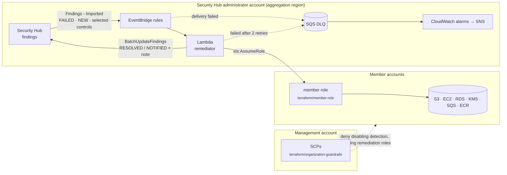

# Security Hub auto-remediation

[](https://github.com/aleksandar-rakic/aws-security-hub-auto-remediation/actions/workflows/ci.yml)


Event-driven remediation of AWS Security Hub findings across an AWS Organization, with
SCP guardrails that keep the detection services and the remediation itself from being
switched off.

A failed control (an S3 bucket open to the public, SSH open to the internet, an unrotated
KMS key) is fixed as soon as Security Hub imports the finding, without waiting for a ticket. Every outcome is
written back onto the finding, so the Security Hub console is the audit trail: what was
changed, what was skipped and why, what failed.

It starts in **dry run**, it never touches a resource tagged `auto-remediation=skip`, and
the disruptive action (isolating an EC2 instance) is a separate opt-in.

## Architecture



1. Security Hub imports a finding with `Compliance.Status = FAILED` and `Workflow.Status = NEW`
   for one of the selected controls. An EventBridge rule matches it.
2. The Lambda reads the resource's current state and its tags, in the finding's own account
   and region (assuming the member role when the finding is in another account).
3. If the resource is non-compliant and not exempt, the Lambda fixes it. The fix is
   idempotent; a finding for an already compliant resource changes nothing.
4. The finding is moved to `RESOLVED` (fixed) or `NOTIFIED` (dry run, exempt, out of reach,
   or failed) with a note. Leaving `NEW` also keeps the rule from firing again.
5. Errors fail the invocation. Lambda retries twice, then the event goes to the dead-letter
   queue and an alarm fires; the finding already carries the error message.

## What it remediates

| Control | Finding | Fix |
| --- | --- | --- |
| [S3.1](https://docs.aws.amazon.com/securityhub/latest/userguide/s3-controls.html#s3-1) | Account-level S3 Block Public Access is off | Turn on all four account-level settings |
| [S3.8](https://docs.aws.amazon.com/securityhub/latest/userguide/s3-controls.html#s3-8) | A bucket does not block public access | Turn on all four bucket-level settings |
| [EC2.7](https://docs.aws.amazon.com/securityhub/latest/userguide/ec2-controls.html#ec2-7) | EBS encryption by default is off | Turn it on in the finding's region |
| [EC2.13](https://docs.aws.amazon.com/securityhub/latest/userguide/ec2-controls.html#ec2-13), [EC2.14](https://docs.aws.amazon.com/securityhub/latest/userguide/ec2-controls.html#ec2-14), [EC2.53](https://docs.aws.amazon.com/securityhub/latest/userguide/ec2-controls.html#ec2-53), [EC2.54](https://docs.aws.amazon.com/securityhub/latest/userguide/ec2-controls.html#ec2-54) | A security group allows `0.0.0.0/0` or `::/0` to port 22 or 3389 | Revoke exactly those rules (including all-traffic rules and port ranges that cover 22/3389); everything else stays |
| [KMS.4](https://docs.aws.amazon.com/securityhub/latest/userguide/kms-controls.html#kms-4) | Customer managed key rotation is off | Turn on automatic rotation |
| [S3.5](https://docs.aws.amazon.com/securityhub/latest/userguide/s3-controls.html#s3-5) | A bucket accepts requests without TLS | Append a `Deny` on `aws:SecureTransport = false` to the bucket policy; existing statements are kept |
| [EC2.2](https://docs.aws.amazon.com/securityhub/latest/userguide/ec2-controls.html#ec2-2) | A VPC default security group has rules | Remove all its rules, but only when no network interface uses the group; otherwise the finding says which interfaces to move first |
| [EC2.1](https://docs.aws.amazon.com/securityhub/latest/userguide/ec2-controls.html#ec2-1) | EBS snapshots in the account are publicly restorable | Remove the `all` group from `createVolumePermission` on each public snapshot in the region; sharing with specific accounts is kept |
| [EC2.8](https://docs.aws.amazon.com/securityhub/latest/userguide/ec2-controls.html#ec2-8) | An instance allows IMDSv1 | Set `HttpTokens=required`, but only when CloudWatch `MetadataNoToken` shows no IMDSv1 calls in the last 14 days; otherwise the finding asks for the software to be updated first |
| [SQS.1](https://docs.aws.amazon.com/securityhub/latest/userguide/sqs-controls.html#sqs-1) | A queue is not encrypted at rest | Turn on SQS-managed encryption (SSE-SQS), which needs no key policy changes; queues already on a KMS key are left alone |
| [EC2.19](https://docs.aws.amazon.com/securityhub/latest/userguide/ec2-controls.html#ec2-19) | A security group allows `0.0.0.0/0` or `::/0` to a high-risk port (FTP, Telnet, SMB, databases, Elasticsearch, 8080, ...) | **Opt-in** (`controls` must list it). Revoke exactly those rules; a service that is meant to be public gets the exemption tag |
| [ECR.1](https://docs.aws.amazon.com/securityhub/latest/userguide/ecr-controls.html#ecr-1) | A private repository does not scan images | Turn on scan on push for that repository (nested names such as `team/app` included) |
| [RDS.1](https://docs.aws.amazon.com/securityhub/latest/userguide/rds-controls.html#rds-1) | A DB or cluster snapshot is public | Remove `all` from the snapshot's `restore` attribute; sharing with specific accounts is kept |
| GuardDuty, HIGH / CRITICAL, `AwsEc2Instance` | An instance is likely compromised | **Opt-in.** Snapshot its EBS volumes, move it into a no-traffic security group, tag it with its previous groups. The instance keeps running for forensics. |

Adding a control is one function in [`remediator/src/remediator/actions.py`](remediator/src/remediator/actions.py),
one entry in `CONTROL_ACTIONS`, its permissions in
[`terraform/policies/remediation-permissions.json`](terraform/policies/remediation-permissions.json)
and tests.

## Safety model

Automatic changes to production need to be more careful than the people they replace.

- **Dry run by default.** `dry_run = true` writes *"Dry run, nothing changed. Would have: …"*
  on each finding. Read those notes for a week, then turn it off.
- **Opt-out per resource.** A bucket that serves a public website, or a bastion that really
  must accept SSH, is tagged `auto-remediation=skip`. Its findings get a note instead of a change.
- **Narrow fixes.** Only the offending security group rules are revoked, not the group;
  public access is blocked, the bucket policy is not rewritten.
- **Idempotent and retry-safe.** Each action reads before it writes, so retries and duplicate
  events do no harm.
- **Nothing is silent.** Every decision is a structured JSON log line and a note on the finding.
  Failures raise, retry, dead-letter and alarm.
- **Least privilege.** The role can change only what the supported controls need
  ([policy](terraform/policies/remediation-permissions.json)); CI rejects wildcard actions in it.
- **Protected by SCPs.** Member accounts cannot disable GuardDuty, Security Hub, Config or
  CloudTrail, nor modify the remediation roles, except through break-glass roles you name.

## Repository layout

```text
remediator/                      Lambda (Python 3.13, boto3 from the runtime)
  src/remediator/handler.py      event loop, sessions per account/region, finding updates
  src/remediator/actions.py      one idempotent function per control
  src/remediator/quarantine.py   GuardDuty EC2 isolation (opt-in)
  tests/                         pytest + moto, no AWS account needed
terraform/
  remediation/                   Lambda, EventBridge rules, DLQ, alarms, IAM
  member-role/                   role assumed in each member account
  organization-guardrails/       service control policies + attachments
  policies/                      remediation permissions shared by both roles
```

## Deploy

Prerequisites: AWS Organizations, Security Hub with a
[delegated administrator](https://docs.aws.amazon.com/securityhub/latest/userguide/designate-orgs-admin-account.html)
and [consolidated control findings](https://docs.aws.amazon.com/securityhub/latest/userguide/controls-findings-create-update.html#consolidated-control-findings)
(the default for new hubs), Terraform ≥ 1.10.

**1. Remediation stack**, in the Security Hub administrator account and aggregation region:

```bash
cd terraform/remediation
terraform init
terraform apply -var region=eu-central-1 -var member_role_name=security-hub-remediation-member
```

**2. Member role**, in every member account (account-vending pipeline, or one provider per account):

```bash
cd terraform/member-role
terraform init
terraform apply -var remediator_role_arn=<role_arn output of step 1>
```

**3. Guardrails**, in the management account. Attach to a sandbox OU first:

```bash
cd terraform/organization-guardrails
terraform init
terraform apply \
  -var 'target_ids=["ou-xxxx-sandbox"]' \
  -var 'exempt_principal_arns=["arn:aws:iam::*:role/break-glass","arn:aws:iam::*:role/terraform-deploy"]' \
  -var 'allowed_regions=["eu-central-1","eu-west-1"]'
```

**4. Leave dry run** once the notes on the findings look right:

```bash
terraform -chdir=terraform/remediation apply -var region=eu-central-1 \
  -var member_role_name=security-hub-remediation-member -var dry_run=false
```

Instance quarantine is enabled separately with `-var quarantine_enabled=true`, after the
incident-response team has agreed on it.

Each stack has a `terraform.tfvars.example` to copy. The rollout order, replaying failed
events from the dead-letter queue, undoing a change and releasing a quarantined instance
are in [docs/operations.md](docs/operations.md).

### Configuration

| Variable | Default | |
| --- | --- | --- |
| `controls` | `null` (all supported except opt-in EC2.19) | Which controls are remediated |
| `dry_run` | `true` | Report only |
| `quarantine_enabled` | `false` | Isolate instances on HIGH/CRITICAL GuardDuty findings |
| `member_role_name` | `""` | Role to assume in other accounts; empty means own account only |
| `exemption_tag` | `auto-remediation=skip` | Tag that opts a resource out |
| `reserved_concurrency` | `null` | Cap on parallel remediations |
| `alarm_actions` | `[]` | SNS topics for the DLQ and error alarms |

### Guardrails

| Policy | Denies | Exempt principals apply |
| --- | --- | --- |
| `protect-security-services` | Disabling or detaching GuardDuty, Security Hub, Config, CloudTrail, Access Analyzer; changing roles named `security-hub-remediation*` | yes |
| | Leaving the organization | no |
| `deny-root-user` | Any action by a member account's root user | no |
| `region-guardrail` (only with `allowed_regions`) | Regional services outside the allowed regions; global services stay usable | yes |

Terraform tests check that every policy stays under the 5,120-character SCP limit, that no
empty `Condition` is rendered and that the organization root cannot be targeted by mistake.

## Development

```bash
cd remediator
python3.13 -m venv .venv && . .venv/bin/activate
pip install -r requirements-dev.txt
ruff format --check . && ruff check . && pytest
```

```bash
for root in remediation member-role organization-guardrails; do
  (cd terraform/$root && terraform init -backend=false && terraform validate && { [ ! -d tests ] || terraform test; })
done
```

The Python tests run every action against [moto](https://github.com/getmoto/moto) and check
both the resource state and the note written to the finding. The Terraform tests plan
against a mocked provider, so neither suite needs AWS credentials.

## Scope

This is a reference implementation written for this repository. It comes from remediating
Security Hub findings by hand in Terraform on a production multi-account AWS platform:
GuardDuty across the organization, IMDSv2, AWS Config, IAM Access Analyzer and service
control policies. This repository turns those fixes into event-driven automation.

What has been checked is the code against moto and the Terraform plans against a mocked
provider. It has not been deployed to a production organization from this repository, and
no remediation latency has been measured. Start in dry run, as described above, and read the
notes on the findings before letting it change anything.

## Limits

- Security groups track connections: a session that was open before quarantine can survive
  until it goes idle. Network ACLs or stopping the instance are the follow-up.
- Only findings whose control ID is present are matched; with consolidated control findings
  turned off, set the rule pattern to `ProductFields.ControlId` instead.
- KMS.4 can only rotate symmetric encryption keys; for other key types the finding is marked
  as failed with the KMS error.

## License

[MIT](LICENSE)
